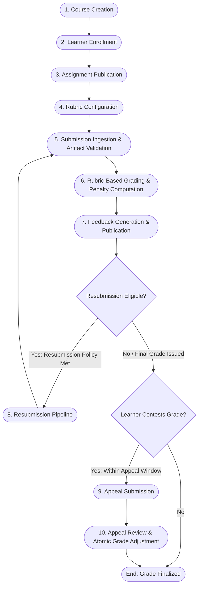

# EduFlow – Assignment and Evaluation Management System
## System Architecture & Technical Design Specification

### 1. Executive Summary

**EduFlow** is an enterprise-grade, full-stack Assignment and Evaluation Management System designed for rigorous higher-education and training environments. The platform manages the end-to-end lifecycle of academic coursework: from course creation, rubric-driven assignment design, and timezone-aware artifact submission to multi-tier grading, feedback distribution, resubmission tracking, and formal academic appeals.

This document outlines the Phase 1 System Architecture, detailing the software design, component topology, integration paradigms, domain models, data engineering specifications, and exception governance models.

---

### 2. Technology Stack & Component Alignment

| Layer | Technology | Version / Specification | Rationale & Architectural Purpose |
| :--- | :--- | :--- | :--- |
| **Frontend** | React + Bootstrap 5 | React 18+, Bootstrap 5.3 | Responsive, component-driven UI; semantic accessibility; standard grid system; rapid styling without heavy design-system boilerplate. |
| **Data Visualization** | Chart.js | 4.x (via react-chartjs-2) | High-performance HTML5 Canvas rendering for score distributions, rubric criteria radar charts, late submission timelines, and appeal metrics. |
| **Backend API** | Python Flask | 3.0+ | Lightweight, highly modular WSGI application with Blueprint routing, factory pattern, and native microservice or monolithic deployment readiness. |
| **ORM / Data Access** | SQLAlchemy | 2.0+ | Advanced relational mapping, strict transactional units of work, Declarative Base, connection pooling, and ACID guarantees. |
| **Validation Engine** | Pydantic v2 & Pandas | Pydantic 2.x, Pandas 2.x | Pydantic handles request/response serialization, type coercion, and domain rule assertion; Pandas powers batch validation, tabular analytics, and synthetic ETL pipelines. |
| **Persistence Store** | PostgreSQL | 15+ | Relational integrity, ANSI SQL compliance, JSONB document storage for flexible feedback/audit states, timezone-aware datetimes (`TIMESTAMPTZ`), and transactional DDL. |
| **Data Generation** | Python, Faker, NumPy | NumPy 1.26+, Faker 24+ | Vectorized statistical sampling (Beta, Poisson, Normal distributions) seeded deterministically (`20261022`) to synthesize enterprise-scale test datasets. |

---

### 3. High-Level Architecture Topology

```
+---------------------------------------------------------------------------------------------------+
|                                          CLIENT TIER                                              |
|                                                                                                   |
|   +-------------------------------------------------------------------------------------------+   |
|   |                       React 18 SPA (Bootstrap 5 UI + Chart.js Engine)                     |   |
|   |  - Student Portal       - Instructor Dashboard       - Grader Workspace   - Appeal Center |   |
|   +-------------------------------------------------------------------------------------------+   |
+--------------------------------------------------+------------------------------------------------+
                                                   | HTTPS / JSON REST APIs
                                                   v
+---------------------------------------------------------------------------------------------------+
|                                      APPLICATION / API TIER                                       |
|                                                                                                   |
|   +-------------------------------------------------------------------------------------------+   |
|   |                                Python Flask RESTful API Gateway                           |   |
|   |     [CORS Middleware]  [Auth / RBAC Guards]  [Timezone Normalizer]  [Audit Interceptor]   |   |
|   +-------------------------------------------------------------------------------------------+   |
|                                                  |                                                |
|       +-------------------+----------------------+--------------------+--------------------+      |
|       v                   v                      v                    v                    v      |
|  +------------+    +---------------+      +--------------+    +---------------+    +------------+ |
|  |   Course   |    |  Assignment   |      |  Submission  |    |  Evaluation   |    |   Appeal   | |
|  |  Blueprint |    |   & Rubric    |      |  & Artifact  |    |   & Feedback  |    | Resolution | |
|  |            |    |   Blueprint   |      |  Blueprint   |    |   Blueprint   |    |  Blueprint | |
|  +------------+    +---------------+      +--------------+    +---------------+    +------------+ |
|       |                   |                      |                    |                    |      |
|   +---+-------------------+----------------------+--------------------+--------------------+--+ |
|   |                           BUSINESS LOGIC & DOMAIN VALIDATION LAYER                        |   |
|   |   - Pydantic DTOs & Domain Schemas           - Late Penalty Engine (Grace Period + Caps)  |   |
|   |   - Missing Artifact Verification            - Rubric Score Sum & Weight Validator        |   |
|   |   - Resubmission Policy Enforcer             - Appeal Audit-Grade Transaction Manager     |   |
|   +-------------------------------------------------------------------------------------------+   |
|                                                  |                                                |
|   +-------------------------------------------------------------------------------------------+   |
|   |                          DATA ACCESS LAYER (SQLAlchemy 2.0 ORM)                           |   |
|   |   - Unit of Work Pattern  - Repositories  - Session Scopes  - Optimistic / Pessimistic Locking|   |
|   +-------------------------------------------------------------------------------------------+   |
+--------------------------------------------------+------------------------------------------------+
                                                   | TCP / Connection Pool (pgbouncer / psycopg2)
                                                   v
+---------------------------------------------------------------------------------------------------+
|                                        PERSISTENCE TIER                                           |
|                                                                                                   |
|   +-------------------------------------------------------------------------------------------+   |
|   |                                   PostgreSQL 15+ Database                                 |   |
|   |  - 11 Mandatory Domain Tables               - 3 Mandatory Supporting Tables               |   |
|   |  - Foreign Key Constraints & Cascades       - CHECK Constraints (Score & Date Bounds)     |   |
|   |  - Composite & GIN Indexes                  - Immutable Event Ledgers (Audit & History)   |   |
|   +-------------------------------------------------------------------------------------------+   |
+---------------------------------------------------------------------------------------------------+
```

---

### 4. Key Architectural Patterns & Design Decisions

#### 4.1. Universal Timezone Normalization (UTC Invariant)
* **Problem**: Academic assignments span across learners, instructors, and campuses in disparate timezones. Storing or calculating due dates in local time causes critical edge-case flaws during Daylight Saving Time (DST) transitions and creates disputes over late submission penalties.
* **Architecture Decision**:
  - Every timestamp in PostgreSQL uses `TIMESTAMP WITH TIME ZONE` (`TIMESTAMPTZ`).
  - Storage is strictly normalized to **UTC** at the database boundary.
  - The `Course` entity stores a primary `timezone` (e.g., `America/New_York`, `UTC`), and the `Learner` entity stores an individual `timezone`.
  - All deadline evaluation logic (`submitted_at <= due_date + grace_period`) is calculated strictly in UTC epoch timestamps.
  - Localization is handled entirely on the client display tier via standard browser `Intl.DateTimeFormat` or server-rendered localized presentation strings.

#### 4.2. Immutable ID Generation Strategy
All primary keys follow deterministic, structured, human-readable, and immutable naming conventions:
- **Assignment**: `ASN-2026-000001` (Type prefix + Calendar Year + 6-digit zero-padded sequence).
- **Rubric**: `RUB-<assignment-id>-01` (Hierarchically linked to assignment + 2-digit version index).
- **Learner**: `LNR-2026-000001` (Consistent prefix + Year + 6-digit zero-padded sequence).
- **Submission**: `SUB-<assignment-id>-<learner-id>-01` (Deterministic composite slug linking Assignment, Learner, and Attempt sequence).
- **Grade**: `GRD-<submission-id>` (1:1 deterministic binding to submission, e.g., `GRD-SUB-ASN-2026-000001-LNR-2026-000001-01`).
- **Appeal**: `APP-2026-000001` (Global sequence for formal appeal records).
- **Course**: `CRS-2026-000001`.
- **Enrollment**: `ENR-2026-000001`.

*Design Rationale*: Structured alphanumeric keys eliminate enumeration attacks common with raw sequential integers, make log parsing and audit tracing trivial across distributed systems, and prevent accidental ID collision during synthetic data generation.

#### 4.3. Append-Only Historical Records & Zero Silent Mutation
* **Rule**: Historical records (grades, submissions, appeal outcomes) are **never deleted or silently overwritten**.
* **Implementation**:
  - `SubmissionStatusHistory`: Logs every state transition (`draft` -> `submitted` -> `under_review` -> `graded` -> `appealed`) with timestamp, triggering user, and change rationale.
  - `AuditLog`: Global immutable ledger tracking `entity_name`, `entity_id`, `action`, `old_values` (JSONB), `new_values` (JSONB), `actor_id`, and network context (`client_ip`, `user_agent`).
  - `Grade` changes resulting from appeals or regrading do not update in-place without generating a linked audit snapshot and status change event.

#### 4.4. Two-Tier Validation Architecture (Pydantic + Pandas)
1. **Request-Level Real-Time Validation (Pydantic v2)**:
   - Evaluates every incoming API payload against strict DTO schemas.
   - Enforces field bounds (e.g., score non-negativity, string length, URI formatting, artifact MIME-types).
   - Rejects invalid requests before they touch database sessions, returning standardized HTTP 422 Unprocessable Entity payloads with granular error paths.
2. **Batch & Data Pipeline Validation (Pandas)**:
   - Utilized by the data ingestion, synthetic data generation, and analytics reporting pipelines.
   - Executes vectorized data consistency assertions: verifying that 30,000 synthetic submissions correspond only to active enrollments, confirming that rubric criteria weights aggregate to 1.0 per rubric, and validating that ground-truth score distributions mirror target distributions.

---

### 5. Core Business Workflows

The system governs the educational lifecycle across 10 sequential, transactional stages:



1. **Course Creation**: Administrator or Instructor registers course metadata (code, term, start/end dates, timezone).
2. **Learner Enrollment**: Learners are enrolled into courses (`active`, `dropped`, `completed`). Enforces uniqueness on `(course_id, learner_id)`.
3. **Assignment Publication**: Instructor defines title, due date, cutoff date, grace period, late penalty schedule, allowed resubmissions, and required artifact types. Status moves from `draft` to `published`.
4. **Rubric Configuration**: Instructor defines the grading rubric with multiple weighted or point-based criteria. The system verifies that criteria point totals match the assignment's maximum score before publishing.
5. **Submission Ingestion & Artifact Validation**:
   - Learner uploads required artifacts (code repositories, PDF reports, datasets).
   - System validates active enrollment, verifies all required artifact types are attached with valid checksums, checks submission timestamp against due date/cutoff, computes late penalty percentage, and marks status as `submitted`.
6. **Rubric-Based Grading**:
   - Evaluator grades each criterion independently.
   - System computes:
     $$\text{Raw Score} = \sum \text{Criterion Scores}$$
     $$\text{Late Penalty} = \text{Raw Score} \times \text{Late Penalty Percentage}$$
     $$\text{Final Score} = \max(0, \min(\text{Raw Score} - \text{Late Penalty} + \text{Bonus}, \text{Max Score}))$$
   - Grade record (`GRD-...`) is immutably created.
7. **Feedback Distribution**: Qualitative and quantitative feedback is published. Status updates to `graded`, triggering visibility to the learner.
8. **Resubmission**: If allowed by assignment policy and prior to cutoff date, learner initiates attempt $N+1$. Original submission remains immutable; a new submission is created and linked via `Resubmission`.
9. **Appeal Ingestion**: Learner files formal appeal within the defined window (e.g., 7 days post-grade publication), citing specific criteria and justifications.
10. **Appeal Decision**: Academic committee or instructor reviews the appeal. An approval triggers an atomic transaction that modifies the grade, records a comprehensive audit trail, and marks the appeal `approved`.

---

### 6. Synthetic Data Engineering Architecture

The technical challenge requires generating synthetic datasets of enterprise volume:
- **1,000 Assignments**
- **10,000 Learners**
- **30,000 Submissions**
- **Deterministic Seed**: `20261022`

#### 6.1. Separation of Ground Truth vs. Operational Input Data
To support rigorous data engineering evaluation, the dataset is partitioned into two distinct domains:
1. **Ground Truth (`ground_truth/`)**:
   - Clean, benchmark reference models.
   - Canonical assignment solutions, ideal rubric score vectors, expected student performance distributions, and true late/on-time status based strictly on simulated clock time.
   - Used for regression testing, scoring validation, and data quality benchmarking.
2. **Application Input Data (`application_input/`)**:
   - Operational database records containing real-world noise:
     - 80% on-time submissions, 15% late submissions (with varied lateness up to cutoff), 5% rejected/unsubmitted.
     - Incomplete submissions (missing artifacts) designed to test exception handlers.
     - Resubmission records (~10% of submissions) and Grade Appeals (~5% of graded submissions).
     - Audit logs capturing historical user agents, client IPs, and state transitions.

#### 6.2. Vectorized Statistical Generation Engine
* **Learner Ability ($\theta$)**: Modeled via Beta distribution $\text{Beta}(\alpha=4, \beta=2)$, scaled to $[0, 100]$ to simulate a realistic bell-curve performance profile.
* **Submission Timing ($t$)**: Modeled relative to assignment due date $D$:
  - On-time: $t \sim \text{Normal}(D - 18\text{ hrs}, 8\text{ hrs})$
  - Late: $t \sim D + \text{Exponential}(\lambda=1.5\text{ days})$
* **Deterministic Seeding**: `numpy.random.seed(20261022)` and `Faker.seed(20261022)` ensure bit-for-bit reproducibility across all environments.

---

### 7. Documentation Roadmap

The complete architectural package includes four specialized specifications within `docs/`:
1. `docs/architecture.md`: System topology, module breakdown, design patterns, and engineering workflows (this document).
2. `docs/database_schema.md`: Full relational DDL, Mermaid ER diagram, constraint definitions, index strategies, and identity schemes.
3. `docs/data_dictionary.md`: Comprehensive column-level dictionary covering all 14 database tables, data types, constraints, nullability, default values, and business descriptions.
4. `docs/business_rules.md`: Exhaustive business logic specifications, algebraic grade formulas, timezone calculations, exception scenario protocols, and synthetic data generation rules.
