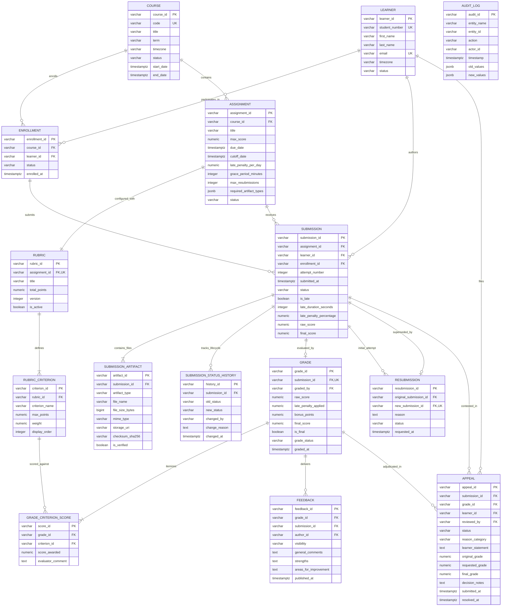

# EduFlow – Database Schema & Entity-Relationship Specification

## 1. Overview & Data Model Design Principles

The **EduFlow** persistence layer is engineered for PostgreSQL 15+, leveraging relational modeling, strict foreign key constraints, temporal state tracking, and JSONB semi-structured logging where appropriate.

### Core Architectural Tenets:
1. **Strict Referential Integrity**: All foreign keys enforce integrity. Deletion is either strictly prohibited (`ON DELETE RESTRICT`) for historical audit safety or governed by cascading soft-deletes where explicitly warranted.
2. **Immutable ID Architecture**: Primary keys follow domain-deterministic alphanumeric patterns (`ASN-2026-000001`, `RUB-<assignment-id>-01`, `SUB-<assignment-id>-<learner-id>-01`, `GRD-<submission-id>`, `APP-2026-000001`).
3. **Temporal Precision**: All temporal attributes use `TIMESTAMP WITH TIME ZONE` (`TIMESTAMPTZ`) normalized to UTC.
4. **Append-Only Auditing**: Historical actions, status updates, and grade revisions are tracked through dedicated immutable event ledgers (`AuditLog`, `SubmissionStatusHistory`, `GradeHistory`).
5. **Score Boundary Verification**: Strict CHECK constraints enforce domain invariants ($0 \le \text{score} \le \text{max\_score}$, non-negative weights, validated enum types).

---

## 2. Entity-Relationship (ER) Diagram

The diagram below documents the 11 mandatory domain entities, the 3 supporting tables (`Enrollment`, `AuditLog`, `SubmissionStatusHistory`), and the criterion evaluation table (`GradeCriterionScore`).



---

## 3. ID Generation Conventions

All primary keys in EduFlow follow standardized, immutable, and deterministic schemes. They do not rely on raw auto-incrementing database integers, ensuring zero enumeration risk and complete audit traceability.

| Entity | ID Format | Example | Generation Rules / Logic |
| :--- | :--- | :--- | :--- |
| **Course** | `CRS-YYYY-NNNNNN` | `CRS-2026-000001` | Prefix `CRS`, creation year, 6-digit sequence. |
| **Learner** | `LNR-YYYY-NNNNNN` | `LNR-2026-000001` | Prefix `LNR`, registration year, 6-digit sequence. |
| **Enrollment** | `ENR-YYYY-NNNNNN` | `ENR-2026-000001` | Prefix `ENR`, calendar year, 6-digit sequence. |
| **Assignment** | `ASN-YYYY-NNNNNN` | `ASN-2026-000001` | Prefix `ASN`, calendar year, 6-digit sequence. Exact format required. |
| **Rubric** | `RUB-<assignment-id>-NN` | `RUB-ASN-2026-000001-01` | Prefix `RUB`, exact assignment ID, 2-digit version. Exact format required. |
| **RubricCriterion** | `CRT-<rubric-id>-NN` | `CRT-RUB-ASN-2026-000001-01-01` | Prefix `CRT`, rubric ID, 2-digit criterion index. |
| **Submission** | `SUB-<assignment-id>-<learner-id>-NN` | `SUB-ASN-2026-000001-LNR-2026-000001-01` | Prefix `SUB`, assignment ID, learner ID, 2-digit attempt number. Exact format required. |
| **SubmissionArtifact** | `ART-<submission-id>-NN` | `ART-SUB-ASN-2026-000001-LNR-2026-000001-01-01` | Prefix `ART`, submission ID, 2-digit artifact index. |
| **Grade** | `GRD-<submission-id>` | `GRD-SUB-ASN-2026-000001-LNR-2026-000001-01` | Prefix `GRD`, 1:1 binding to submission ID. Exact format required. |
| **GradeCriterionScore**| `GCS-<grade-id>-NN` | `GCS-GRD-SUB-...-01` | Prefix `GCS`, grade ID, 2-digit criterion index. |
| **Feedback** | `FBK-<grade-id>-NN` | `FBK-GRD-SUB-ASN-2026-000001-LNR-2026-000001-01-01` | Prefix `FBK`, grade ID, 2-digit feedback iteration index. |
| **Resubmission** | `RSB-YYYY-NNNNNN` | `RSB-2026-000001` | Prefix `RSB`, calendar year, 6-digit sequence. |
| **Appeal** | `APP-YYYY-NNNNNN` | `APP-2026-000001` | Prefix `APP`, calendar year, 6-digit sequence. Exact format required. |
| **StatusHistory** | `SSH-YYYY-NNNNNN` | `SSH-2026-000001` | Prefix `SSH`, calendar year, 6-digit sequence. |
| **AuditLog** | `AUD-YYYY-NNNNNN` | `AUD-2026-000001` | Prefix `AUD`, calendar year, 6-digit sequence. |

---

## 4. Relationship Cardinality & Constraints Matrix

| Parent Entity | Child Entity | Cardinality | FK Column | On Delete | Constraint / Relationship Nature |
| :--- | :--- | :--- | :--- | :--- | :--- |
| `Course` | `Enrollment` | 1 : N | `course_id` | RESTRICT | Many learners enroll in one course. |
| `Learner` | `Enrollment` | 1 : N | `learner_id` | RESTRICT | One learner has many course enrollments. |
| `Course` | `Assignment` | 1 : N | `course_id` | RESTRICT | A course contains multiple published assignments. |
| `Assignment` | `Rubric` | 1 : 1 (Active) | `assignment_id` | RESTRICT | Unique `(assignment_id, version)` constraint; 1 active rubric per assignment. |
| `Rubric` | `RubricCriterion`| 1 : N | `rubric_id` | CASCADE | Deleting/archiving a draft rubric cascades to its criteria. |
| `Assignment` | `Submission` | 1 : N | `assignment_id` | RESTRICT | Assignment receives multiple submissions across learners. |
| `Learner` | `Submission` | 1 : N | `learner_id` | RESTRICT | Learner authors submissions. |
| `Enrollment` | `Submission` | 1 : N | `enrollment_id` | RESTRICT | Mandatory: submission must trace to an active enrollment. |
| `Submission` | `SubmissionArtifact`| 1 : N | `submission_id` | CASCADE | Artifacts belong to a specific submission attempt. |
| `Submission` | `Grade` | 1 : 1 | `submission_id` | RESTRICT | Exactly one grade record per submission attempt (`UNIQUE(submission_id)`). |
| `Grade` | `GradeCriterionScore`| 1 : N | `grade_id` | CASCADE | Criterion-level scores detailing the rubric breakdown. |
| `Grade` | `Feedback` | 1 : N | `grade_id` | RESTRICT | Instructor/TA attaches feedback records to a grade. |
| `Submission` | `Resubmission` | 1 : N (Original)| `original_submission_id` | RESTRICT | Original attempt 1 points to resubmission metadata. |
| `Submission` | `Resubmission` | 1 : 1 (New) | `new_submission_id` | RESTRICT | New attempt (2+) represents the resubmission result. |
| `Submission` | `Appeal` | 1 : N | `submission_id` | RESTRICT | Submission contested via formal academic appeal. |
| `Grade` | `Appeal` | 1 : N | `grade_id` | RESTRICT | Contested grade linked to appeal. |
| `Submission` | `SubmissionStatusHistory`| 1 : N | `submission_id` | CASCADE | Temporal event trail of all submission status changes. |

---

## 5. PostgreSQL DDL Schema Definitions

The following SQL DDL represents the production schema with all domain constraints, enums, checks, foreign keys, and indexes.

```sql
-- =============================================================================
-- EduFlow PostgreSQL Schema Definition
-- PostgreSQL 15+ Compatible
-- =============================================================================

-- Enable UUID extension if required for non-domain keys
CREATE EXTENSION IF NOT EXISTS "uuid-ossp";

-- -----------------------------------------------------------------------------
-- DOMAIN ENUMS
-- -----------------------------------------------------------------------------
CREATE TYPE course_status AS ENUM ('draft', 'active', 'archived');
CREATE TYPE enrollment_status AS ENUM ('active', 'dropped', 'completed', 'suspended');
CREATE TYPE assignment_status AS ENUM ('draft', 'published', 'closed', 'archived');
CREATE TYPE submission_status AS ENUM ('draft', 'submitted', 'under_review', 'graded', 'resubmitted', 'appealed');
CREATE TYPE artifact_type AS ENUM ('code_repository', 'report_pdf', 'dataset_csv', 'video_presentation', 'supplementary_zip');
CREATE TYPE grade_status AS ENUM ('provisional', 'published', 'revised', 'disputed');
CREATE TYPE feedback_visibility AS ENUM ('learner_visible', 'internal_staff_only');
CREATE TYPE resubmission_status AS ENUM ('requested', 'approved', 'rejected', 'submitted');
CREATE TYPE appeal_status AS ENUM ('submitted', 'under_review', 'approved', 'rejected', 'withdrawn');
CREATE TYPE appeal_reason_category AS ENUM (
    'calculation_error',
    'rubric_misinterpretation',
    'missing_artifact_reconsideration',
    'extenuating_circumstances'
);
CREATE TYPE audit_action_type AS ENUM (
    'INSERT',
    'UPDATE',
    'DELETE',
    'STATUS_CHANGE',
    'GRADE_OVERRIDE',
    'APPEAL_DECISION',
    'ARTIFACT_VERIFICATION'
);

-- -----------------------------------------------------------------------------
-- 1. COURSE
-- -----------------------------------------------------------------------------
CREATE TABLE course (
    course_id VARCHAR(32) PRIMARY KEY, -- CRS-2026-000001
    code VARCHAR(32) NOT NULL UNIQUE,
    title VARCHAR(255) NOT NULL,
    description TEXT,
    department VARCHAR(100) NOT NULL,
    term VARCHAR(32) NOT NULL,
    timezone VARCHAR(64) NOT NULL DEFAULT 'UTC',
    status course_status NOT NULL DEFAULT 'draft',
    start_date TIMESTAMPTZ NOT NULL,
    end_date TIMESTAMPTZ NOT NULL,
    created_at TIMESTAMPTZ NOT NULL DEFAULT CURRENT_TIMESTAMP,
    updated_at TIMESTAMPTZ NOT NULL DEFAULT CURRENT_TIMESTAMP,
    CONSTRAINT chk_course_dates CHECK (end_date > start_date)
);

CREATE INDEX idx_course_code ON course (code);
CREATE INDEX idx_course_status ON course (status);

-- -----------------------------------------------------------------------------
-- 2. LEARNER
-- -----------------------------------------------------------------------------
CREATE TABLE learner (
    learner_id VARCHAR(32) PRIMARY KEY, -- LNR-2026-000001
    student_number VARCHAR(64) NOT NULL UNIQUE,
    first_name VARCHAR(100) NOT NULL,
    last_name VARCHAR(100) NOT NULL,
    email VARCHAR(255) NOT NULL UNIQUE,
    timezone VARCHAR(64) NOT NULL DEFAULT 'UTC',
    status enrollment_status NOT NULL DEFAULT 'active',
    created_at TIMESTAMPTZ NOT NULL DEFAULT CURRENT_TIMESTAMP,
    updated_at TIMESTAMPTZ NOT NULL DEFAULT CURRENT_TIMESTAMP
);

CREATE INDEX idx_learner_email ON learner (email);
CREATE INDEX idx_learner_student_number ON learner (student_number);

-- -----------------------------------------------------------------------------
-- 3. ENROLLMENT (Supporting Table: M:N Course <-> Learner)
-- -----------------------------------------------------------------------------
CREATE TABLE enrollment (
    enrollment_id VARCHAR(32) PRIMARY KEY, -- ENR-2026-000001
    course_id VARCHAR(32) NOT NULL REFERENCES course(course_id) ON DELETE RESTRICT,
    learner_id VARCHAR(32) NOT NULL REFERENCES learner(learner_id) ON DELETE RESTRICT,
    status enrollment_status NOT NULL DEFAULT 'active',
    enrolled_at TIMESTAMPTZ NOT NULL DEFAULT CURRENT_TIMESTAMP,
    dropped_at TIMESTAMPTZ,
    created_at TIMESTAMPTZ NOT NULL DEFAULT CURRENT_TIMESTAMP,
    updated_at TIMESTAMPTZ NOT NULL DEFAULT CURRENT_TIMESTAMP,
    CONSTRAINT uq_course_learner UNIQUE (course_id, learner_id)
);

CREATE INDEX idx_enrollment_course ON enrollment (course_id);
CREATE INDEX idx_enrollment_learner ON enrollment (learner_id);
CREATE INDEX idx_enrollment_status ON enrollment (status);

-- -----------------------------------------------------------------------------
-- 4. ASSIGNMENT
-- -----------------------------------------------------------------------------
CREATE TABLE assignment (
    assignment_id VARCHAR(32) PRIMARY KEY, -- ASN-2026-000001
    course_id VARCHAR(32) NOT NULL REFERENCES course(course_id) ON DELETE RESTRICT,
    title VARCHAR(255) NOT NULL,
    description TEXT,
    max_score NUMERIC(5, 2) NOT NULL DEFAULT 100.00,
    due_date TIMESTAMPTZ NOT NULL,
    cutoff_date TIMESTAMPTZ NOT NULL,
    late_penalty_per_day NUMERIC(4, 2) NOT NULL DEFAULT 5.00, -- e.g., 5.00%
    max_late_days INTEGER NOT NULL DEFAULT 3,
    grace_period_minutes INTEGER NOT NULL DEFAULT 15,
    max_resubmissions INTEGER NOT NULL DEFAULT 1,
    required_artifact_types JSONB NOT NULL DEFAULT '["report_pdf"]'::jsonb,
    status assignment_status NOT NULL DEFAULT 'draft',
    created_at TIMESTAMPTZ NOT NULL DEFAULT CURRENT_TIMESTAMP,
    updated_at TIMESTAMPTZ NOT NULL DEFAULT CURRENT_TIMESTAMP,
    CONSTRAINT chk_assignment_max_score CHECK (max_score > 0),
    CONSTRAINT chk_assignment_dates CHECK (cutoff_date >= due_date),
    CONSTRAINT chk_assignment_penalty CHECK (late_penalty_per_day >= 0 AND late_penalty_per_day <= 100),
    CONSTRAINT chk_assignment_grace CHECK (grace_period_minutes >= 0),
    CONSTRAINT chk_assignment_resubmissions CHECK (max_resubmissions >= 0)
);

CREATE INDEX idx_assignment_course ON assignment (course_id);
CREATE INDEX idx_assignment_status ON assignment (status);
CREATE INDEX idx_assignment_due_date ON assignment (due_date);
CREATE INDEX idx_assignment_artifacts_gin ON assignment USING gin (required_artifact_types);

-- -----------------------------------------------------------------------------
-- 5. RUBRIC
-- -----------------------------------------------------------------------------
CREATE TABLE rubric (
    rubric_id VARCHAR(64) PRIMARY KEY, -- RUB-ASN-2026-000001-01
    assignment_id VARCHAR(32) NOT NULL REFERENCES assignment(assignment_id) ON DELETE RESTRICT,
    title VARCHAR(255) NOT NULL,
    description TEXT,
    total_points NUMERIC(5, 2) NOT NULL DEFAULT 100.00,
    version INTEGER NOT NULL DEFAULT 1,
    is_active BOOLEAN NOT NULL DEFAULT TRUE,
    created_at TIMESTAMPTZ NOT NULL DEFAULT CURRENT_TIMESTAMP,
    updated_at TIMESTAMPTZ NOT NULL DEFAULT CURRENT_TIMESTAMP,
    CONSTRAINT uq_rubric_assignment_version UNIQUE (assignment_id, version),
    CONSTRAINT chk_rubric_total_points CHECK (total_points > 0)
);

CREATE INDEX idx_rubric_assignment ON rubric (assignment_id);

-- -----------------------------------------------------------------------------
-- 6. RUBRIC_CRITERION
-- -----------------------------------------------------------------------------
CREATE TABLE rubric_criterion (
    criterion_id VARCHAR(96) PRIMARY KEY, -- CRT-RUB-ASN-2026-000001-01-01
    rubric_id VARCHAR(64) NOT NULL REFERENCES rubric(rubric_id) ON DELETE CASCADE,
    criterion_name VARCHAR(255) NOT NULL,
    description TEXT,
    max_points NUMERIC(5, 2) NOT NULL,
    weight NUMERIC(4, 2) NOT NULL DEFAULT 1.00, -- Normalized multiplier or weight
    display_order INTEGER NOT NULL DEFAULT 1,
    created_at TIMESTAMPTZ NOT NULL DEFAULT CURRENT_TIMESTAMP,
    updated_at TIMESTAMPTZ NOT NULL DEFAULT CURRENT_TIMESTAMP,
    CONSTRAINT chk_criterion_max_points CHECK (max_points > 0),
    CONSTRAINT chk_criterion_weight CHECK (weight > 0)
);

CREATE INDEX idx_criterion_rubric ON rubric_criterion (rubric_id);

-- -----------------------------------------------------------------------------
-- 7. SUBMISSION
-- -----------------------------------------------------------------------------
CREATE TABLE submission (
    submission_id VARCHAR(96) PRIMARY KEY, -- SUB-ASN-2026-000001-LNR-2026-000001-01
    assignment_id VARCHAR(32) NOT NULL REFERENCES assignment(assignment_id) ON DELETE RESTRICT,
    learner_id VARCHAR(32) NOT NULL REFERENCES learner(learner_id) ON DELETE RESTRICT,
    enrollment_id VARCHAR(32) NOT NULL REFERENCES enrollment(enrollment_id) ON DELETE RESTRICT,
    attempt_number INTEGER NOT NULL DEFAULT 1,
    submitted_at TIMESTAMPTZ NOT NULL DEFAULT CURRENT_TIMESTAMP,
    status submission_status NOT NULL DEFAULT 'submitted',
    is_late BOOLEAN NOT NULL DEFAULT FALSE,
    late_duration_seconds INTEGER NOT NULL DEFAULT 0,
    late_penalty_percentage NUMERIC(5, 2) NOT NULL DEFAULT 0.00,
    raw_score NUMERIC(5, 2),
    final_score NUMERIC(5, 2),
    learner_notes TEXT,
    created_at TIMESTAMPTZ NOT NULL DEFAULT CURRENT_TIMESTAMP,
    updated_at TIMESTAMPTZ NOT NULL DEFAULT CURRENT_TIMESTAMP,
    CONSTRAINT uq_submission_attempt UNIQUE (assignment_id, learner_id, attempt_number),
    CONSTRAINT chk_submission_attempt CHECK (attempt_number >= 1),
    CONSTRAINT chk_submission_late_duration CHECK (late_duration_seconds >= 0),
    CONSTRAINT chk_submission_late_penalty CHECK (late_penalty_percentage >= 0 AND late_penalty_percentage <= 100),
    CONSTRAINT chk_submission_scores CHECK (
        (raw_score IS NULL OR raw_score >= 0) AND
        (final_score IS NULL OR final_score >= 0)
    )
);

CREATE INDEX idx_submission_assignment ON submission (assignment_id);
CREATE INDEX idx_submission_learner ON submission (learner_id);
CREATE INDEX idx_submission_status ON submission (status);
CREATE INDEX idx_submission_submitted_at ON submission (submitted_at);
CREATE INDEX idx_submission_lookup ON submission (assignment_id, learner_id, status);

-- -----------------------------------------------------------------------------
-- 8. SUBMISSION_ARTIFACT
-- -----------------------------------------------------------------------------
CREATE TABLE submission_artifact (
    artifact_id VARCHAR(128) PRIMARY KEY, -- ART-SUB-ASN-2026-000001-LNR-2026-000001-01-01
    submission_id VARCHAR(96) NOT NULL REFERENCES submission(submission_id) ON DELETE CASCADE,
    artifact_type artifact_type NOT NULL,
    file_name VARCHAR(255) NOT NULL,
    file_size_bytes BIGINT NOT NULL,
    mime_type VARCHAR(128) NOT NULL,
    storage_uri VARCHAR(512) NOT NULL,
    checksum_sha256 VARCHAR(64) NOT NULL,
    is_verified BOOLEAN NOT NULL DEFAULT TRUE,
    uploaded_at TIMESTAMPTZ NOT NULL DEFAULT CURRENT_TIMESTAMP,
    CONSTRAINT chk_artifact_size CHECK (file_size_bytes > 0),
    CONSTRAINT uq_submission_artifact_type UNIQUE (submission_id, artifact_type)
);

CREATE INDEX idx_artifact_submission ON submission_artifact (submission_id);
CREATE INDEX idx_artifact_type ON submission_artifact (artifact_type);

-- -----------------------------------------------------------------------------
-- 9. GRADE
-- -----------------------------------------------------------------------------
CREATE TABLE grade (
    grade_id VARCHAR(112) PRIMARY KEY, -- GRD-SUB-ASN-2026-000001-LNR-2026-000001-01
    submission_id VARCHAR(96) NOT NULL UNIQUE REFERENCES submission(submission_id) ON DELETE RESTRICT,
    graded_by VARCHAR(64) NOT NULL, -- Instructor / TA ID
    raw_score NUMERIC(5, 2) NOT NULL,
    late_penalty_applied NUMERIC(5, 2) NOT NULL DEFAULT 0.00,
    bonus_points NUMERIC(5, 2) NOT NULL DEFAULT 0.00,
    final_score NUMERIC(5, 2) NOT NULL,
    is_final BOOLEAN NOT NULL DEFAULT FALSE,
    grade_status grade_status NOT NULL DEFAULT 'provisional',
    graded_at TIMESTAMPTZ NOT NULL DEFAULT CURRENT_TIMESTAMP,
    created_at TIMESTAMPTZ NOT NULL DEFAULT CURRENT_TIMESTAMP,
    updated_at TIMESTAMPTZ NOT NULL DEFAULT CURRENT_TIMESTAMP,
    CONSTRAINT chk_grade_scores CHECK (
        raw_score >= 0 AND
        late_penalty_applied >= 0 AND
        bonus_points >= 0 AND
        final_score >= 0
    )
);

CREATE INDEX idx_grade_submission ON grade (submission_id);
CREATE INDEX idx_grade_status ON grade (grade_status);
CREATE INDEX idx_grade_graded_by ON grade (graded_by);

-- -----------------------------------------------------------------------------
-- 9B. GRADE_CRITERION_SCORE (Itemized Rubric Scoring Breakdown)
-- -----------------------------------------------------------------------------
CREATE TABLE grade_criterion_score (
    score_id VARCHAR(128) PRIMARY KEY, -- GCS-GRD-SUB-...-01
    grade_id VARCHAR(112) NOT NULL REFERENCES grade(grade_id) ON DELETE CASCADE,
    criterion_id VARCHAR(96) NOT NULL REFERENCES rubric_criterion(criterion_id) ON DELETE RESTRICT,
    score_awarded NUMERIC(5, 2) NOT NULL,
    evaluator_comment TEXT,
    created_at TIMESTAMPTZ NOT NULL DEFAULT CURRENT_TIMESTAMP,
    CONSTRAINT uq_grade_criterion UNIQUE (grade_id, criterion_id),
    CONSTRAINT chk_criterion_score_awarded CHECK (score_awarded >= 0)
);

CREATE INDEX idx_gcs_grade ON grade_criterion_score (grade_id);
CREATE INDEX idx_gcs_criterion ON grade_criterion_score (criterion_id);

-- -----------------------------------------------------------------------------
-- 10. FEEDBACK
-- -----------------------------------------------------------------------------
CREATE TABLE feedback (
    feedback_id VARCHAR(128) PRIMARY KEY, -- FBK-GRD-SUB-...-01
    grade_id VARCHAR(112) NOT NULL REFERENCES grade(grade_id) ON DELETE RESTRICT,
    submission_id VARCHAR(96) NOT NULL REFERENCES submission(submission_id) ON DELETE RESTRICT,
    author_id VARCHAR(64) NOT NULL,
    visibility feedback_visibility NOT NULL DEFAULT 'learner_visible',
    general_comments TEXT NOT NULL,
    strengths TEXT,
    areas_for_improvement TEXT,
    published_at TIMESTAMPTZ NOT NULL DEFAULT CURRENT_TIMESTAMP,
    created_at TIMESTAMPTZ NOT NULL DEFAULT CURRENT_TIMESTAMP,
    updated_at TIMESTAMPTZ NOT NULL DEFAULT CURRENT_TIMESTAMP
);

CREATE INDEX idx_feedback_grade ON feedback (grade_id);
CREATE INDEX idx_feedback_submission ON feedback (submission_id);

-- -----------------------------------------------------------------------------
-- 11. RESUBMISSION
-- -----------------------------------------------------------------------------
CREATE TABLE resubmission (
    resubmission_id VARCHAR(32) PRIMARY KEY, -- RSB-2026-000001
    original_submission_id VARCHAR(96) NOT NULL REFERENCES submission(submission_id) ON DELETE RESTRICT,
    new_submission_id VARCHAR(96) NOT NULL UNIQUE REFERENCES submission(submission_id) ON DELETE RESTRICT,
    reason TEXT NOT NULL,
    change_summary TEXT,
    approved_by VARCHAR(64),
    status resubmission_status NOT NULL DEFAULT 'submitted',
    requested_at TIMESTAMPTZ NOT NULL DEFAULT CURRENT_TIMESTAMP,
    reviewed_at TIMESTAMPTZ,
    created_at TIMESTAMPTZ NOT NULL DEFAULT CURRENT_TIMESTAMP,
    updated_at TIMESTAMPTZ NOT NULL DEFAULT CURRENT_TIMESTAMP,
    CONSTRAINT chk_resubmission_distinct CHECK (original_submission_id <> new_submission_id)
);

CREATE INDEX idx_resubmission_original ON resubmission (original_submission_id);
CREATE INDEX idx_resubmission_new ON resubmission (new_submission_id);

-- -----------------------------------------------------------------------------
-- 12. APPEAL
-- -----------------------------------------------------------------------------
CREATE TABLE appeal (
    appeal_id VARCHAR(32) PRIMARY KEY, -- APP-2026-000001
    submission_id VARCHAR(96) NOT NULL REFERENCES submission(submission_id) ON DELETE RESTRICT,
    grade_id VARCHAR(112) NOT NULL REFERENCES grade(grade_id) ON DELETE RESTRICT,
    learner_id VARCHAR(32) NOT NULL REFERENCES learner(learner_id) ON DELETE RESTRICT,
    reviewed_by VARCHAR(64), -- Nullable until assigned to an academic committee member
    status appeal_status NOT NULL DEFAULT 'submitted',
    reason_category appeal_reason_category NOT NULL,
    learner_statement TEXT NOT NULL,
    contested_criteria JSONB, -- Array of criterion IDs contested
    original_grade NUMERIC(5, 2) NOT NULL,
    requested_grade NUMERIC(5, 2),
    final_grade NUMERIC(5, 2),
    decision_notes TEXT,
    submitted_at TIMESTAMPTZ NOT NULL DEFAULT CURRENT_TIMESTAMP,
    resolved_at TIMESTAMPTZ,
    created_at TIMESTAMPTZ NOT NULL DEFAULT CURRENT_TIMESTAMP,
    updated_at TIMESTAMPTZ NOT NULL DEFAULT CURRENT_TIMESTAMP,
    CONSTRAINT chk_appeal_grades CHECK (
        original_grade >= 0 AND
        (requested_grade IS NULL OR requested_grade >= 0) AND
        (final_grade IS NULL OR final_grade >= 0)
    )
);

CREATE INDEX idx_appeal_submission ON appeal (submission_id);
CREATE INDEX idx_appeal_grade ON appeal (grade_id);
CREATE INDEX idx_appeal_learner ON appeal (learner_id);
CREATE INDEX idx_appeal_status ON appeal (status);
CREATE INDEX idx_appeal_submitted_at ON appeal (submitted_at);

-- -----------------------------------------------------------------------------
-- 13. SUBMISSION_STATUS_HISTORY (Supporting Table: Temporal State Transitions)
-- -----------------------------------------------------------------------------
CREATE TABLE submission_status_history (
    history_id VARCHAR(32) PRIMARY KEY, -- SSH-2026-000001
    submission_id VARCHAR(96) NOT NULL REFERENCES submission(submission_id) ON DELETE CASCADE,
    old_status submission_status,
    new_status submission_status NOT NULL,
    changed_by VARCHAR(64) NOT NULL,
    change_reason TEXT,
    changed_at TIMESTAMPTZ NOT NULL DEFAULT CURRENT_TIMESTAMP
);

CREATE INDEX idx_ssh_submission ON submission_status_history (submission_id);
CREATE INDEX idx_ssh_changed_at ON submission_status_history (changed_at);

-- -----------------------------------------------------------------------------
-- 14. AUDIT_LOG (Supporting Table: Universal Immutable Audit Trail)
-- -----------------------------------------------------------------------------
CREATE TABLE audit_log (
    audit_id VARCHAR(32) PRIMARY KEY, -- AUD-2026-000001
    entity_name VARCHAR(64) NOT NULL,
    entity_id VARCHAR(128) NOT NULL,
    action audit_action_type NOT NULL,
    actor_id VARCHAR(64) NOT NULL,
    actor_role VARCHAR(32) NOT NULL DEFAULT 'system',
    timestamp TIMESTAMPTZ NOT NULL DEFAULT CURRENT_TIMESTAMP,
    old_values JSONB,
    new_values JSONB,
    client_ip VARCHAR(45),
    user_agent TEXT
);

CREATE INDEX idx_audit_entity ON audit_log (entity_name, entity_id);
CREATE INDEX idx_audit_timestamp ON audit_log (timestamp);
CREATE INDEX idx_audit_actor ON audit_log (actor_id);
CREATE INDEX idx_audit_action ON audit_log (action);
CREATE INDEX idx_audit_old_values_gin ON audit_log USING gin (old_values);
CREATE INDEX idx_audit_new_values_gin ON audit_log USING gin (new_values);
```

---

## 6. Indexing & Query Optimization Strategy

1. **Composite Lookup Indexes**:
   - `idx_submission_lookup (assignment_id, learner_id, status)`: Accelerates the primary query used during learner submission authorization and duplicate checking.
   - `uq_course_learner (course_id, learner_id)`: Guarantees unique enrollment while creating an underlying B-tree index for instantaneous enrollment status verification.
2. **Temporal Range Indexes**:
   - `idx_submission_submitted_at`: Supports fast batch filtering for late penalty reconciliation and deadline analytics dashboards.
   - `idx_audit_timestamp`: Essential for time-sliced audit reporting and forensic log retrieval.
3. **GIN Semi-Structured Indexes**:
   - `idx_assignment_artifacts_gin`: JSONB inverted index on `required_artifact_types` enables fast set containment queries (e.g., finding assignments requiring `code_repository`).
   - `idx_audit_old_values_gin` & `idx_audit_new_values_gin`: Enables index-backed searching through JSON state snapshots to trace historical grade changes by value.
